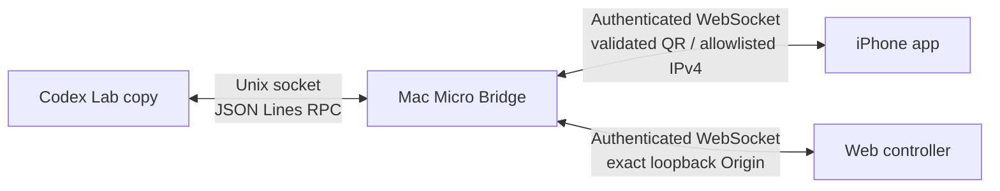

# Codex Micro Lab

[日本語](README.md) · [English](README.en.md) · [简体中文](README.zh-CN.md)

[](https://github.com/42libft/codex-micro-lab/actions/workflows/ci.yml) [](LICENSE)

A hardware-free research PoC for reproducing the Codex Micro settings UI and testing its RPC, input, and lighting paths on a Mac.

## The 30-second version

| Goal | Result |
| --- | --- |
| Show Codex's Micro settings UI | Yes. The historical state is changed reversibly with a backup |
| Test inputs without hardware | Yes. Use the Mac web controller |
| Use an iPhone as a controller | Yes. iPhone → Mac bridge → Codex |
| Make an iPhone act as USB/BLE HID | No with the tested public iOS APIs |
| Present a true virtual HID to unmodified Codex | Only with Apple's virtual HID entitlement |

This is an independent research project, not an OpenAI product. The repository does not contain Codex binaries, ASAR files, signing material, or pairing tokens. The compatibility target is pinned to Codex `26.803.41515 (6321)`.

> **Transport constraint:** the authenticated iPhone path uses `ws://`; it has no TLS or end-to-end encryption. Use only a network you control and do not send sensitive text. Renderer traffic is restricted to the `0600` Unix socket, and thread keys, titles, skill/command names, and layout assignments are not broadcast over LAN. See the [security model](SECURITY.md).

## Architecture



The Mac bridge looks like the Micro RPC endpoint to Codex and like a controller service to the iPhone and browser. The iPhone sends high-level Agent Key, Command Key, dial, and joystick events; it does not impersonate a USB HID device.

## Quick start: Mac only

```sh
git clone https://github.com/42libft/codex-micro-lab.git
cd codex-micro-lab
npm ci
npm test
npm run build
node dist/src/cli.js start
```

Open the printed web-controller URL to try. The bearer token is not printed or placed in that URL.

- Agent Keys `AG00`–`AG05`
- Command Keys `ACT06`–`ACT12`
- dial press and rotation
- joystick movement with safe zero-on-release
- ambient, key, and thread lighting received from Codex

Keep the bridge on a trusted local network. The QR contains only allowlisted non-global IPv4 candidates, and the iPhone asks you to confirm the destination before connecting. There is no Bonjour fallback. Do not expose the port to the internet.

## Show the settings UI only

Quit the regular Codex app first, then run:

```sh
node dist/src/cli.js inspect
node dist/src/cli.js doctor
node dist/src/cli.js ui enable
```

Restart Codex to check the settings entry. Restore the original state with:

```sh
node dist/src/cli.js ui restore
```

`ui enable` backs up `~/.codex/.codex-global-state.json` under
`~/Library/Application Support/Codex Micro Lab/state-backups/` and changes only the Micro detection history. It does not modify the Codex app. If the account-side Feature Gate is disabled, the regular app may still hide the setting.

## Connect an iPhone

1. Start `node dist/src/cli.js start` on the Mac.
2. Open `ios/CodexMicroLab.xcodeproj` in Xcode.
3. Add an Apple Account and choose your own Team under Signing & Capabilities.
4. Enable Developer Mode on the iPhone.
5. Run the app on the physical iPhone.
6. Scan the QR shown by the Mac with “QRを読み取る” in the app.

After selecting an Apple Account and Team once in Xcode, you can use the helper command below to detect, build, and install the newest source on a reachable iPhone:

```sh
npm run ios:install
```

The helper uses `0600` temporary files, hides device identifiers, asks which device to use when several are paired, and separately confirms provisioning updates and installation. It installs but does not launch the app.

The scanner accepts only a version-1 `codexmicro://pair` QR containing a 32-character hexadecimal token, one or more allowlisted non-global IPv4 addresses, and a port from 1024 through 65535. Network changes require scanning a new QR and confirming the destination again.

The app is intentionally foreground-only. Locking or backgrounding it disconnects the controller; returning to the app reconnects. See the [iOS client README](ios/CodexMicroLab/README.md) for details.

## Useful commands

```sh
# Read-only diagnostics
node dist/src/cli.js inspect
node dist/src/cli.js doctor

# Start the bridge and web controller
node dist/src/cli.js start

# Reversible UI state change
node dist/src/cli.js ui enable
node dist/src/cli.js ui status
node dist/src/cli.js ui restore

# Research Lab copy (quit regular Codex first)
node dist/src/cli.js lab build
node dist/src/cli.js lab launch
```

## Documentation

| Document | What it contains |
| --- | --- |
| Technical article | Kept outside this public repository as a personal draft until it is edited and published on a separate technical-article platform |
| [Protocol notes](docs/protocol.md) | HID framing, RPC, and bridge envelopes |
| [Verification log](docs/verification.md) | Tested environments, commands, results, and open work |
| [iOS README](ios/CodexMicroLab/README.md) | Xcode, device, Personal Hotspot, and BLE probe instructions |
| [Security notes](SECURITY.md) | Information that must not be published and network cautions |
| [Contributing](CONTRIBUTING.md) | Checks for issues and pull requests |

## Limitations

- A Codex update requires re-analysis of the ASAR hash, `CodexMicroService`, and Feature Gate occurrence count.
- On the tested physical iPhone, the public API rejected HID Service `0x1812` with `CBErrorDomain Code=8`.
- The Lab copy is for local research and is not covered by official updates or OpenAI support.
- A true macOS virtual HID backend requires Apple's `com.apple.developer.hid.virtual.device` entitlement.

## UI customization

The web controller and iPhone app in this public repository intentionally start with a small, research-oriented UI. They are not meant to prescribe a final product look. Please grow the UI into something comfortable for your users or team. You can edit `web/index.html` and `ios/CodexMicroLab/ContentView.swift` to change colors, labels, spacing, and layout while keeping the versioned transport protocol and safe input-release handling intact.

## License

[MIT License](LICENSE). The project does not guarantee the accuracy of undocumented Codex internals.
