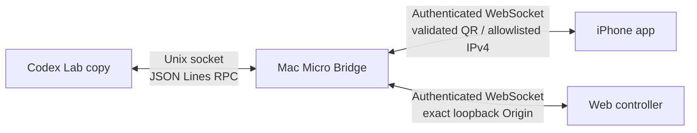

# Codex Micro Lab

[日本語](README.md) · [English](README.en.md) · [简体中文](README.zh-CN.md)

[](https://github.com/42libft/codex-micro-lab/actions/workflows/ci.yml) [](LICENSE)

Codex Microを持っていないMacで、専用UI・RPC・入力・照明の経路を検証する研究用PoCです。

## 30秒で分かること

| やりたいこと | 結果 |
| --- | --- |
| Codexの専用Micro設定を表示する | できる。永続状態をバックアップ付きで可逆変更 |
| Macだけで入力を試す | できる。Webコントローラを使用 |
| iPhoneを操作パネルにする | できる。iPhone → Macブリッジ → Codex |
| iPhoneをUSB/BLE HIDにする | 今回のiOS公開APIではできなかった |
| 未改変CodexにOSレベルの仮想HIDを見せる | Appleの仮想HID entitlement取得時だけ可能 |

これはOpenAI公式製品ではありません。Codex本体、ASAR、署名情報、ペアリングトークンはリポジトリに含めません。対応対象はCodex `26.803.41515 (6321)`に固定しています。

> **通信上の制約:** iPhone経路は認証付きですが`ws://`で、TLS/E2E暗号化はありません。自分が管理するLANまたはPersonal Hotspotだけで使い、機密テキストは送信しないでください。rendererは`0600` Unix socket専用で、LANへはthread key・タイトル・skill/command名・layoutを送信しません。詳しくは[Security model](SECURITY.md)を参照してください。

## 仕組み



MacブリッジがCodex側にはMicroのRPC終端として見え、iPhoneとWebブラウザには操作パネルとして見えます。iPhoneはHIDを偽装せず、Agent Key、Command Key、ダイヤル、ジョイスティックを高レベル入力として送信します。

## 最短手順：Macだけで試す

```sh
git clone https://github.com/42libft/codex-micro-lab.git
cd codex-micro-lab
npm ci
npm test
npm run build
node dist/src/cli.js start
```

`start`はWebコントローラとペアリングQRを自動でブラウザに表示します。トークンはターミナルやWeb controllerのURLへ表示しません。QRをあとから再表示したいときは、別のターミナルで次を実行します。

```sh
node dist/src/cli.js qr
```

次を試せます。

- Agent Key `AG00`〜`AG05`
- Command Key `ACT06`〜`ACT12`
- ダイヤル押下・左右回転
- ジョイスティックと離したときのゼロ復帰
- Codexから届くambient／key／thread照明

ブリッジは信頼できるローカルネットワーク上だけで使ってください。QRにはallowlist済みのnon-global IPv4だけが入り、iPhoneは確認画面を出してから直接接続します。Bonjour fallbackはありません。インターネットへポート公開する設計ではありません。

## 専用UIだけを表示する

正規Codexを終了してから、プロジェクトのルートで実行します。

```sh
node dist/src/cli.js inspect
node dist/src/cli.js doctor
node dist/src/cli.js ui enable
```

Codexを再起動して設定を確認したら、元に戻せます。

```sh
node dist/src/cli.js ui restore
```

`ui enable`は`~/.codex/.codex-global-state.json`を
`~/Library/Application Support/Codex Micro Lab/state-backups/`へ退避してから、Micro検出履歴だけを変更します。Codexアプリ本体は変更しません。Feature Gateがアカウント側で無効な場合、正規アプリには設定が出ないことがあります。

## iPhoneを接続する

1. Macで`node dist/src/cli.js start`を起動する（QRは自動表示）
2. `ios/CodexMicroLab.xcodeproj`をXcodeで開く
3. Apple Accountを追加し、Signing & Capabilitiesで自分のTeamを選ぶ
4. iPhoneのDeveloper Modeを有効にする
5. iPhoneをRun先にして起動する
6. 初回だけ、Macに表示されたQRをアプリの「QRを読み取る」で読む

XcodeでApple AccountとTeamを一度選んだ後は、接続可能なiPhoneを自動検出してビルド・インストールする補助コマンドも使えます。

```sh
npm run ios:install
```

このコマンドは一時ファイルを`0600`で作り、端末IDを表示せず、複数端末では選択を求めます。Appleのprovisioning更新と実機installはそれぞれ確認後にだけ実行します。install後の自動launchは行いません。

QRのトークンと接続先はMac側とiPhoneのKeychain／app preferencesに保存されます。同じallowlist済みIPであれば、2回目以降は保存済みIPへ再接続します。ネットワーク構成が変わった場合は`node dist/src/cli.js qr`でQRを再表示し、接続先をもう一度確認してください。QRは`codexmicro://pair`、version 1、32桁hex token、allowlist済みnon-global IPv4、1024〜65535番portだけを受け付けます。

アプリはフォアグラウンド仕様です。画面ロックやバックグラウンド移行では切断扱いになり、戻ると再接続します。詳しくは[iOSクライアントREADME](ios/CodexMicroLab/README.md)を参照してください。

## よく使うコマンド

```sh
# Codexと環境の読み取り専用診断
node dist/src/cli.js inspect
node dist/src/cli.js doctor

# Webブリッジを起動
node dist/src/cli.js start
# ペアリングQRをもう一度表示
node dist/src/cli.js qr

# UIの可逆変更
node dist/src/cli.js ui enable
node dist/src/cli.js ui status
node dist/src/cli.js ui restore

# 研究用Labコピー（正規Codexを終了してから）
node dist/src/cli.js lab build
node dist/src/cli.js lab launch
```

## ドキュメント

| 資料 | 内容 |
| --- | --- |
| 技術記事 | 公開リポジトリには含めず、外部プラットフォームで公開する前提の個人用草稿として別管理 |
| [プロトコルノート](docs/protocol.md) | HID framing、RPC、ブリッジのJSON envelope |
| [検証ログ](docs/verification.md) | 確認済みの環境、コマンド、実験結果、残課題 |
| [iOS README](ios/CodexMicroLab/README.md) | Xcode、実機、Personal Hotspot、BLE probeの手順 |
| [Security notes](SECURITY.md) | 公開してはいけない情報とネットワーク上の注意 |
| [Contributing](CONTRIBUTING.md) | Issue／Pull Requestを送る前のチェック |

## 制約

- Codex更新時はASARハッシュ、`CodexMicroService`、Feature Gate件数の再解析が必要です。
- iOS公開APIでは、今回の実機でHID Service `0x1812`が`CBErrorDomain Code=8`で拒否されました。
- Lab版は研究用のコピーであり、公式アップデートやOpenAIのサポート対象ではありません。
- macOSのtrue virtual HIDは、Appleの`com.apple.developer.hid.virtual.device` entitlement取得時だけ追加できます。

## UIについて

公開リポジトリのWebコントローラとiPhoneアプリは、通信経路を検証するための初期UIです。完成品の外観を固定するものではありません。実際に使う人やチームが操作しやすいUIへ育てることをおすすめします。`web/index.html` と `ios/CodexMicroLab/ContentView.swift` を編集すれば、通信プロトコルと入力時の安全処理を保ったまま、色・ラベル・配置・レイアウトを変更できます。

## ライセンス

[MIT License](LICENSE)。研究成果やCodex内部実装の正確性を保証するものではありません。
