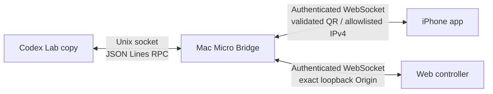

# Codex Micro Lab

[日本語](README.md) · [English](README.en.md) · [简体中文](README.zh-CN.md)

[](https://github.com/42libft/codex-micro-lab/actions/workflows/ci.yml) [](LICENSE)

这是一个无需 Codex Micro 硬件的研究型 PoC，用于复现 Codex Micro 设置界面，并在 Mac 上测试 RPC、输入和灯光链路。

## 30 秒了解项目

| 目标 | 结果 |
| --- | --- |
| 显示 Codex 的 Micro 设置界面 | 可以。带备份、可逆地修改历史检测状态 |
| 不使用硬件测试输入 | 可以。使用 Mac Web 控制器 |
| 用 iPhone 作为控制器 | 可以。iPhone → Mac bridge → Codex |
| 让 iPhone 充当 USB/BLE HID | 使用本次测试的 iOS 公开 API 不可以 |
| 让未修改的 Codex 看到真正的虚拟 HID | 只有取得 Apple virtual HID entitlement 才可能 |

这是独立的研究项目，不是 OpenAI 官方产品。仓库不包含 Codex 二进制文件、ASAR、签名材料或配对 token。当前兼容目标固定为 Codex `26.803.41515 (6321)`。

> **传输限制：** iPhone 路径虽然有身份验证，但使用`ws://`，没有 TLS 或端到端加密。只能在自己管理的网络中使用，不要发送敏感文本。renderer 通信只走`0600` Unix socket；thread key、标题、skill/command 名称和 layout 不会广播到局域网。详情见[安全模型](SECURITY.md)。

## 架构



Mac bridge 对 Codex 表现为 Micro RPC 终端，对 iPhone 和浏览器表现为控制器服务。iPhone 发送 Agent Key、Command Key、旋钮和摇杆等高层输入，并不伪装成 USB HID 设备。

## 最短路径：只使用 Mac

```sh
git clone https://github.com/42libft/codex-micro-lab.git
cd codex-micro-lab
npm ci
npm test
npm run build
node dist/src/cli.js start
```

打开命令输出的 Web 控制器地址即可测试。bearer token 不会打印，也不会放进该 URL。

- Agent Key `AG00`–`AG05`
- Command Key `ACT06`–`ACT12`
- 旋钮按下和旋转
- 松手后安全回到零点的摇杆
- Codex 返回的 ambient、key、thread 灯光

请只在可信的局域网中运行 bridge。二维码只包含 allowlist 允许的 non-global IPv4，iPhone 会在连接前显示目标供确认。没有 Bonjour fallback。不要把端口暴露到互联网。

## 只显示专用设置界面

先退出正常的 Codex，然后执行：

```sh
node dist/src/cli.js inspect
node dist/src/cli.js doctor
node dist/src/cli.js ui enable
```

重启 Codex 检查设置入口。恢复原状态：

```sh
node dist/src/cli.js ui restore
```

`ui enable`会把`~/.codex/.codex-global-state.json`备份到
`~/Library/Application Support/Codex Micro Lab/state-backups/`，只修改 Micro 检测历史，不修改 Codex 应用本体。如果账号侧 Feature Gate 未启用，正常 Codex 仍可能隐藏该设置。

## 连接 iPhone

1. 在 Mac 上启动`node dist/src/cli.js start`。
2. 在 Xcode 中打开`ios/CodexMicroLab.xcodeproj`。
3. 添加 Apple Account，并在 Signing & Capabilities 中选择自己的 Team。
4. 在 iPhone 上启用 Developer Mode。
5. 选择实体 iPhone 运行应用。
6. 在应用中点击“QRを読み取る”，扫描 Mac 显示的二维码。

在 Xcode 中选择 Apple Account 和 Team 一次后，可以使用下面的辅助命令自动检测、构建并安装最新源码：

```sh
npm run ios:install
```

辅助脚本使用`0600`临时文件、隐藏设备 ID；检测到多台 iPhone 时会要求选择，并分别确认 provisioning 更新和安装。脚本只安装，不会自动启动应用。

扫描器只接受 version 1 的`codexmicro://pair`二维码，其中必须包含 32 位十六进制 token、allowlist 允许的 non-global IPv4 和 1024–65535 端口。网络变化后必须重新扫描并确认目标。

应用设计为只在前台运行。锁屏或切到后台会断开控制器，回到应用后会重新连接。详情请看[iOS客户端 README](ios/CodexMicroLab/README.md)。

## 常用命令

```sh
# 只读诊断
node dist/src/cli.js inspect
node dist/src/cli.js doctor

# 启动 bridge 和 Web 控制器
node dist/src/cli.js start

# 可逆的 UI 状态修改
node dist/src/cli.js ui enable
node dist/src/cli.js ui status
node dist/src/cli.js ui restore

# 研究用 Lab 副本（先退出正常 Codex）
node dist/src/cli.js lab build
node dist/src/cli.js lab launch
```

## 文档

| 文档 | 内容 |
| --- | --- |
| 技术文章 | 不放入这个公开仓库；作为个人草稿单独保存，编辑后再发布到其他技术文章平台 |
| [协议笔记](docs/protocol.md) | HID framing、RPC 和 bridge JSON envelope |
| [验证日志](docs/verification.md) | 已测试环境、命令、结果和未完成事项 |
| [iOS README](ios/CodexMicroLab/README.md) | Xcode、实体设备、Personal Hotspot 和 BLE probe |
| [安全说明](SECURITY.md) | 不应公开的信息和网络注意事项 |
| [贡献指南](CONTRIBUTING.md) | 提交 Issue／Pull Request 前的检查 |

## 限制

- Codex 更新后需要重新分析 ASAR hash、`CodexMicroService` 和 Feature Gate 出现次数。
- 在测试用实体 iPhone 上，iOS 公开 API 以`CBErrorDomain Code=8`拒绝了 HID Service `0x1812`。
- Lab 副本仅用于本地研究，不属于官方更新或 OpenAI 支持范围。
- 真正的 macOS virtual HID backend 需要 Apple 的`com.apple.developer.hid.virtual.device` entitlement。

## 关于 UI

公开仓库中的 Web 控制器和 iPhone 应用从一个用于验证通信链路的最小初始 UI 开始，并不限制最终外观。请根据使用者或团队的习惯，把 UI 继续打磨得更易用。你可以编辑 `web/index.html` 和 `ios/CodexMicroLab/ContentView.swift`，在保留版本化通信协议和安全 release 处理的前提下，自定义颜色、文字、间距和布局。

## 许可证

[MIT License](LICENSE)。本项目不保证未公开 Codex 内部实现的准确性。
